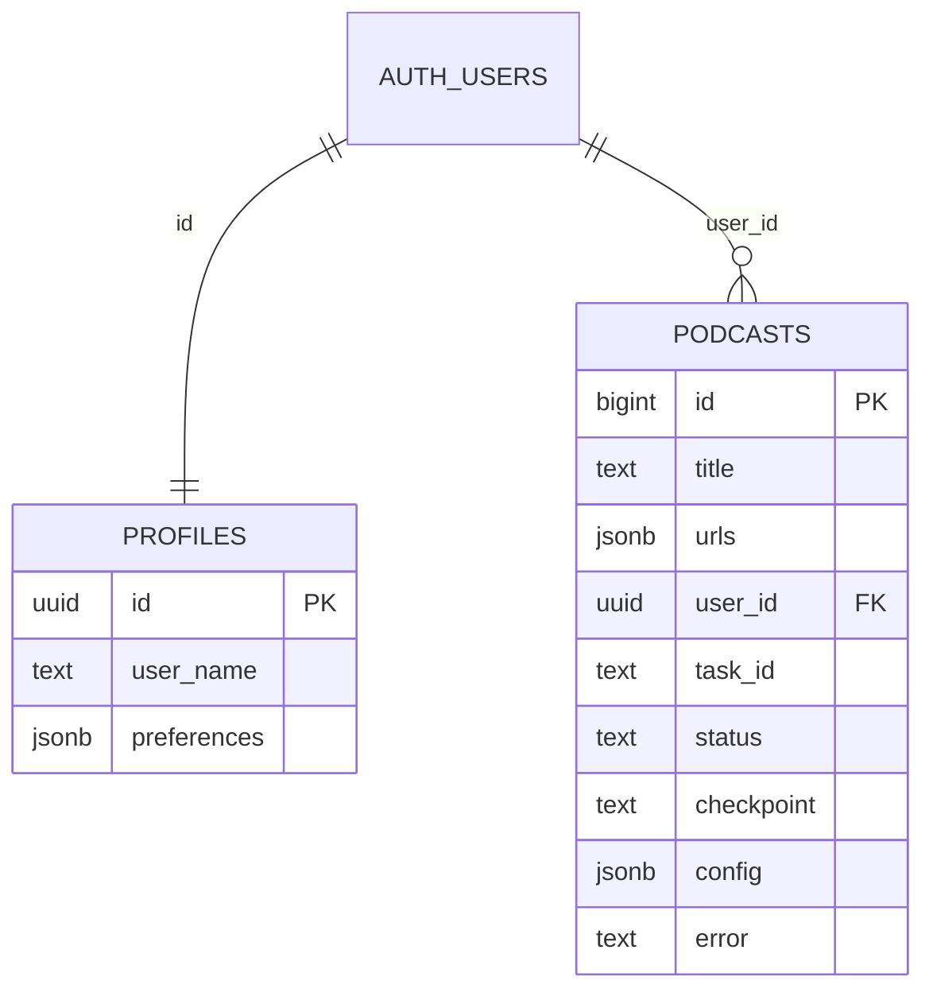

# Supabase Schema
## Tables

### `public.profiles`

| Column | Type | Notes |
|---|---|---|
| `id` | `uuid` | PK, user identifier (matches `auth.users.id`) |
| `user_name` | `text` | user name |
| `preferences` | `jsonb` | includes `preferred_hosts` |

`preferences` example:

```json
{
  "preferred_hosts": ["sarah_curious", "mike_expert"]
}
```

### `public.podcasts`

| Column | Type | Notes |
|---|---|---|
| `id` | `bigint` | PK (identity) |
| `title` | `text` | podcast topic/title |
| `urls` | `jsonb` | output artifact URLs |
| `user_id` | `uuid` | FK to `auth.users.id` |
| `task_id` | `text` | stable creation task/storage identifier |
| `status` | `text` | `queued`, `processing`, `failed`, or `completed` |
| `checkpoint` | `text` | last completed checkpoint: `requested`, `pipeline` (YAML saved), a stage id per finished stage, then `audio`, `transcript`, `completed` |
| `config` | `jsonb` | normalized create-podcast payload plus the frozen plan: `inputs` and `stages` |
| `error` | `text` | latest failure message, if any |
| `created_at` | `timestamptz` | creation timestamp |
| `updated_at` | `timestamptz` | update timestamp |

`urls` example (one entry per checkpoint; stage keys are the stage ids of the episode's pipeline YAML):

```json
{
  "pipeline": "https://.../pipeline.yaml",
  "architect": "https://.../blueprint.json",
  "researcher": "https://.../research.md",
  "outliner": "https://.../outline.json",
  "scriptwriter": "https://.../script.txt",
  "audio": "https://...",
  "transcript": "https://...",
  "transcript_vtt": "https://..."
}
```

`config` example (`format` is a pipeline id; `inputs` are the pipeline's resolved inputs, frozen at creation):

```json
{
  "topic": "History of packet switching",
  "host_ids": ["sarah_curious", "mike_expert"],
  "format": "duo_long",
  "inputs": {"topic": "History of packet switching", "host_profiles": "...", "host_name": "Sarah"},
  "stages": ["architect", "researcher", "outliner", "scriptwriter"]
}
```

The pipeline YAML itself is saved as a file in the episode's storage folder (`urls.pipeline`), not in the
database; no column was added for it.

## Relationships (visual)



## Buckets

| Item | Value |
|---|---|
| Bucket name | `SUPABASE_STORAGE_BUCKET` (from environment) |
| Path pattern | `{user_id}/{task_id}/{file_name}` |
| Upload mode | `upsert = true` |
| URL type | Public URL (`get_public_url`) |

Example object path:

```text
2f6e.../9a13.../transcript.vtt
```

## Trigger

- On `auth.users` insert, a default `profiles` row is created automatically.
